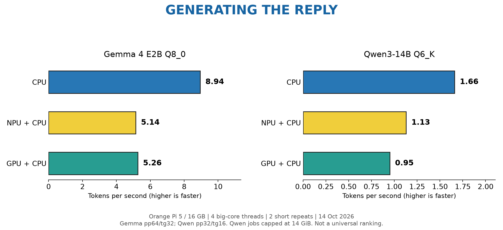
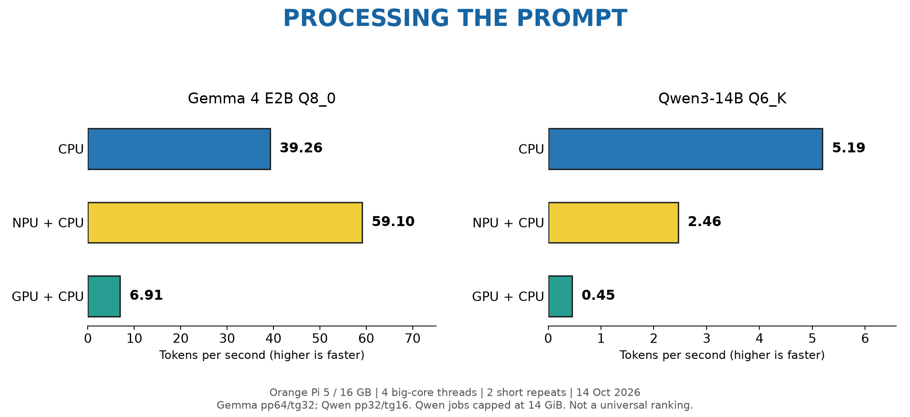

# Measured Results

Measured 2026-10-14 on Orange Pi 5 / RK3588S, 16GB RAM, NVMe, vendor kernel
6.1.115, GNU 15.2, pinned fork `81eff6a45`. Vendor Mali g24p0, Vulkan 1.3.276.
CPU-only used a separate build with NPU/Vulkan disabled. Hardware activity was
sampled to verify which accelerator actually ran, not inferred from CLI labels.

## Results




| Model | Backend | Prompt tokens/s | Generated tokens/s |
|---|---|---:|---:|
| Gemma 4 E2B Q8_0, 5.05 GB | CPU only | 39.26 | 8.94 |
| Same file | NPU + CPU | 59.10 | 5.14 |
| Same file | Vulkan + CPU | 6.91 | 5.26 |
| Qwen3-14B Q6_K, 12.12 GB | CPU only | 5.19 | 1.66 |
| Same file | NPU + CPU fallbacks | 2.46 | 1.13 |
| Same file | Vulkan + CPU | 0.45 | 0.95 |

CPU was fastest at generation on both files. NPU improved small-Gemma prompt
processing, but not larger-Qwen performance. GPU worked but was not the fastest.
Do not turn these two samples into a universal backend ranking.

## Method And Limits

- Four threads pinned to big cores 4-7; normal on-demand governors; two repeats.
- Gemma: pp64/tg32, batch/ubatch 128. Qwen: pp32/tg16, batch/ubatch 64.
- Host-side KV cache and operation-offload suppression for accepted comparisons.
- Qwen jobs: 14 GiB cgroup cap, test-job swap disabled, 512 MiB host-available
  guard, 600-second timeout. NPU hit the cap and incurred reclaim, so its result
  is conditional on that protected budget. Vendor allocations can escape cgroup
  accounting; host-wide memory was monitored separately.
- Lowest sampled host available RAM for Qwen: CPU 4.25 GiB, GPU 3.45 GiB,
  NPU 1.61 GiB. All three jobs completed; the normal services were restored.
- CPU load samples: GPU/NPU 0%. GPU samples: up to 100%, NPU 0%. NPU samples:
  up to 78% on Gemma and 96% on Qwen, GPU 0%.
- Token rates exclude setup/warm-up costs. First loads, NPU conversion and model
  switching can be much slower than the steady token rate suggests.
- Short performance probes, not model-quality, long-context, sustained thermal,
  vision or speech evaluations. No simultaneous CPU+GPU+NPU benchmark performed.

## Reproduce A Short Probe

Stop other inference jobs first; do not benchmark alongside another loaded model.
Use an exact existing GGUF path. CPU and GPU examples below share one workload;
the CPU executable must come from the CPU-only build.

```bash
model="$HOME/ai-test-models/Qwen3-14B-Q6_K.gguf"
taskset -c 4-7 /opt/rk-llama.cpp/build-cpu/bin/llama-bench \
  -m "$model" -t 4 -p 32 -n 16 -b 64 -ub 64 -r 2 \
  --device none -ngl 0 -nkvo 1 -nopo 1
# For GPU: use the vendor LD_LIBRARY_PATH/VK_DRIVER_FILES from the GPU guide.
taskset -c 4-7 /opt/rk-llama.cpp/build-vulkan/bin/llama-bench \
  -m "$model" -t 4 -p 32 -n 16 -b 64 -ub 64 -r 2 \
  --device Vulkan0 -ngl 999 -nkvo 1 -nopo 1
# For NPU: use the NPU build, --device RKNPU, and raise file-descriptor limit.
ulimit -n 102400
taskset -c 4-7 /opt/rk-llama.cpp/build/bin/llama-bench \
  -m "$model" -t 4 -p 32 -n 16 -b 64 -ub 64 -r 2 \
  --device RKNPU -ngl 999 -nkvo 1 -nopo 1
```

These bare commands do not install the memory cap/timeout used in the protected
Qwen experiment. Monitor RAM, limit the job through systemd/cgroups as appropriate,
and stop if host memory is depleted. Restore the chosen server/WebUI after testing.

## Memory: Four Different Numbers

Mali reported a 15.58 GiB shared heap, an 8 GiB maximum single allocation,
a 2 GiB storage-buffer range and 32 KiB workgroup shared memory. These are not
interchangeable. Workgroup scratch space is not model storage. Heap size is not
a guarantee of free RAM. The 12.12 GB Qwen completed with 41/41 layers offloaded
and about 10.7 GiB GPU model buffers: 8 GiB is not a total-model-size ceiling.

## Provenance

[Official Qwen GGUF](https://huggingface.co/Qwen/Qwen3-14B-GGUF) at revision
`530227a7d994db8eca5ab5ced2fb692b614357fd`; SHA256:
`ec1f1d1421d7636a23e17645cac6fda39ee4b5f1f11e42eb09238089705ef699`.
Gemma files match pinned Unsloth publisher revisions; see
[model provenance](model-provenance.md). No weights or private raw server logs
are included in this repo.
