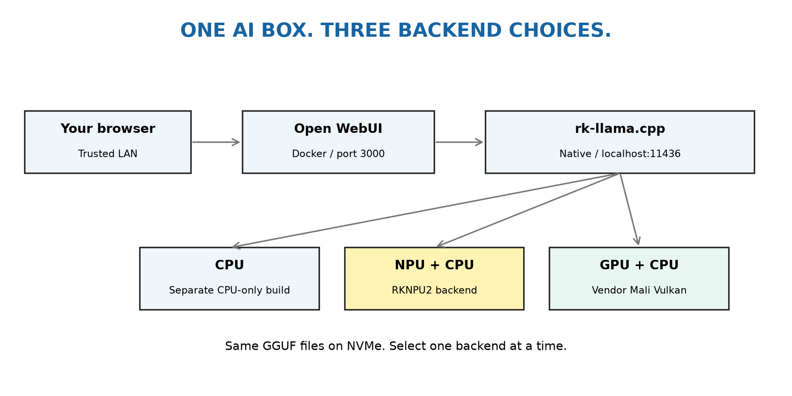

# CPU, NPU And Vulkan GPU

Checked on Orange Pi 5, 16GB, vendor kernel 6.1.115 on 2026-10-14.
Start with the [base installation](armbian-npu-open-webui.md): OS, pinned
source, `ai` account/groups, shared GGUF library, cache and Docker/Open WebUI.
The backend is native rk-llama.cpp, not the historical RKLLama Docker stack.



Keep separate build folders. All three use the same GGUF files and API port.
Run one backend at a time. Leave the working kernel/NPU service untouched while
testing. The GPU driver below stays isolated, not globally installed.

## 1. NPU

Use the base guide's `/opt/rk-llama.cpp/build`, compiled with
`-DLLAMA_RKNPU2=ON -DGGML_VULKAN=OFF`. Install `deploy/llama-npu.service`.
It is the default. Unsupported work still runs on CPU; this is not NPU-only.

```bash
sudo systemctl start llama-npu
sudo watch -n 0.5 cat /sys/kernel/debug/rknpu/load
```

Issue an API request in another terminal using `scripts/verify-live-model`.
Device listing may report NPU memory as zero; that is not a zero-memory device.

## 2. Genuine CPU-Only Build

The mixed build used its accelerator backend even with `--device none`, zero
offloaded layers and host-operation offload disabled. A separate CPU-only build
is the reliable baseline for this pinned fork.

```bash
cmake -S /opt/rk-llama.cpp -B /opt/rk-llama.cpp/build-cpu \
  -DCMAKE_BUILD_TYPE=Release -DLLAMA_RKNPU2=OFF -DGGML_VULKAN=OFF \
  -DGGML_OPENCL=OFF -DLLAMA_BUILD_TESTS=OFF
cmake --build /opt/rk-llama.cpp/build-cpu \
  --target llama-server llama-cli llama-bench -j4
/opt/rk-llama.cpp/build-cpu/bin/llama-cli --list-devices
```

No NPU/Vulkan accelerator should be listed. The CPU-only build, alternative
server templates, model replies and WebUI backend connectivity passed live
validation and controlled reboots on 2026-10-14. Still validate your own board.

## 3. Enable Vendor Mali Vulkan Without A Kernel Change

Mesa PanVK is not interchangeable with the vendor Mali kernel binding. On this
image, the default Mesa probe found only llvmpipe (software rendering). Having
`vulkaninfo` or a loaded panfrost module did not prove GPU acceleration.

Install tools from the configured Ubuntu repositories:

```bash
sudo apt-get update
sudo apt-get install -y --no-install-recommends \
  vulkan-tools mesa-vulkan-drivers libvulkan-dev glslc libwayland-server0
vulkaninfo --summary
readlink /sys/devices/platform/fb000000.gpu/driver
ls -l /dev/mali0
```

The accepted binding was `mali`, with `/dev/mali0`. Do not unbind the GPU or
change overlays/kernel based only on these example paths. Other images need
their own compatible driver recipe.

Review the package's upstream license before using its proprietary binaries:
[Mali package source](https://github.com/ginkage/libmali-rockchip).
Extract the exact tested package into a private installation path. This avoids
package maintainer scripts, global library replacement and a global ICD change.

```bash
sudo install -d -m 755 -o ai -g ai /opt/rk-mali-vulkan
cd /opt/rk-mali-vulkan
test ! -e mali.deb && test ! -e extracted
curl -fL --retry 3 -o mali.deb \
  https://github.com/ginkage/libmali-rockchip/releases/download/v1.9-1-04f8711/libmali-valhall-g610-g24p0-wayland-gbm_1.9-1_arm64.deb
printf '%s  mali.deb\n' \
  72db2d1d27761d2692c9e5050cc9347fae8ec47eba4342dce0d5e18e2bbccdba \
  | sha256sum -c -
dpkg-deb -x mali.deb extracted
export LD_LIBRARY_PATH=/opt/rk-mali-vulkan/extracted/usr/lib/aarch64-linux-gnu/mali:/opt/rk-mali-vulkan/extracted/usr/lib/aarch64-linux-gnu
export VK_DRIVER_FILES=/opt/rk-mali-vulkan/extracted/usr/share/vulkan/icd.d/mali.json
vulkaninfo --summary
```

Require `Mali-G610`, integrated GPU and ARM proprietary driver, not llvmpipe.
Missing display/surface messages on a headless system are separate from device
enumeration. Do not bypass Vulkan initialization failures with an experimental
driver flag and call that a supported setup.

Build in another folder. This reproduces the tested mixed-backend build; always
select Vulkan explicitly and check that NPU stays idle during the GPU test.

```bash
cmake -S /opt/rk-llama.cpp -B /opt/rk-llama.cpp/build-vulkan \
  -DCMAKE_BUILD_TYPE=Release -DLLAMA_RKNPU2=ON -DGGML_VULKAN=ON \
  -DGGML_OPENCL=OFF -DLLAMA_BUILD_TESTS=OFF
cmake --build /opt/rk-llama.cpp/build-vulkan \
  --target llama-server llama-cli llama-bench -j4
/opt/rk-llama.cpp/build-vulkan/bin/llama-cli --list-devices
```

Use `--device Vulkan0 --n-gpu-layers 999 --no-kv-offload --no-op-offload`.
Keeping the KV cache on CPU avoided a descriptor-set assertion with full GPU
offload. Eight-layer partial offload still asserted on the tested Gemma. Do not
promise arbitrary offload combinations work with this pinned backend/driver.

Watch GPU load in another terminal:

```bash
watch -n 0.5 cat /sys/class/devfreq/fb000000.gpu/load
```

## 4. A Publisher-Verified Large Model

Official [Qwen3-14B Q6_K](https://huggingface.co/Qwen/Qwen3-14B-GGUF) is
12,121,937,248 bytes (12.12 GB / 11.29 GiB). It completed CPU/GPU/NPU benchmarks
on this board with short contexts. That is not a long-context or quality claim.
Publisher license: Apache-2.0; retain the publisher's LICENSE/NOTICE as applicable.

Download to an experiment folder first, not automatically to the NPU router:

```bash
mkdir -p ~/ai-test-models
cd ~/ai-test-models
test ! -e Qwen3-14B-Q6_K.gguf && test ! -e Qwen3-14B-Q6_K.gguf.part
curl -fL --retry 3 -o Qwen3-14B-Q6_K.gguf.part \
  https://huggingface.co/Qwen/Qwen3-14B-GGUF/resolve/530227a7d994db8eca5ab5ced2fb692b614357fd/Qwen3-14B-Q6_K.gguf
printf '%s  Qwen3-14B-Q6_K.gguf.part\n' \
  ec1f1d1421d7636a23e17645cac6fda39ee4b5f1f11e42eb09238089705ef699 \
  | sha256sum -c -
mv -n Qwen3-14B-Q6_K.gguf.part Qwen3-14B-Q6_K.gguf
```

File size is not runtime RAM use. NPU conversion retained substantial CPU-side
data and created additional buffers; the protected job hit its memory cap.
GPU used about 10.7 GiB of model buffers. Its reported 8 GiB *single allocation*
limit did not restrict total model size to 8 GiB. See the benchmark guide.

## 5. Persistent Alternative Services And Open WebUI

Templates share localhost port 11436 and use `ai`. Inspect paths/user/group
settings before installation. Do not start them concurrently with the NPU unit.
The templates use a 512-token context and batch/ubatch 64 for bounded initial
validation; raise context only after measuring RAM. CPU was fastest for Qwen.

```bash
cd ~/rk-llama-server-setup
sudo install -m 644 deploy/llama-cpu.service /etc/systemd/system/
sudo install -m 644 deploy/llama-vulkan.service /etc/systemd/system/
sudo systemctl daemon-reload
```

Choose one provider below: `llama-cpu`, `llama-vulkan`, or `llama-npu`.
The existing WebUI unit requires NPU, so selecting a different backend also
requires changing that dependency. This intentional switch interrupts chat.
Inspect and retain the existing full WebUI unit and its drop-ins before
replacing it. Dependency lists such as Requires cannot be removed by setting
an empty Requires in a drop-in. Render the complete supplied unit instead.
If older backend drop-ins exist, review/retire them first: they can re-add a
conflicting backend dependency even when the main unit has been replaced.

For the verified Qwen file, place it in the shared library before using these
router service templates. Refuse to overwrite another copy:

```bash
test ! -e /srv/ai-models/Qwen3-14B-Q6_K.gguf
mv -n ~/ai-test-models/Qwen3-14B-Q6_K.gguf /srv/ai-models/
```

```bash
backend=llama-cpu
case "$backend" in llama-cpu|llama-vulkan|llama-npu) ;; *) exit 1 ;; esac
sudo systemctl stop open-webui-stack
for unit in llama-npu llama-cpu llama-vulkan; do
  if systemctl cat "$unit.service" >/dev/null 2>&1; then
    sudo systemctl disable --now "$unit.service"
  fi
done
sed "s/llama-npu.service/$backend.service/g" deploy/open-webui-stack.service \
  | sudo tee /etc/systemd/system/open-webui-stack.service >/dev/null
sudo systemctl daemon-reload
sudo systemctl enable --now "$backend.service"
sudo systemctl start open-webui-stack
```

Return to the original setup with the same block and `backend=llama-npu`.
Switching keeps WebUI data and model files; it does not reset accounts or chats.
All providers use the same API URL, so Compose does not need changing.

Validate the chosen unit, both API health endpoints, a real model reply,
hardware activity and browser chat separately. Then test a controlled reboot.
CPU, Vulkan and restored NPU each passed a separate controlled reboot on the
tested board. Open WebUI needed time synchronization and container startup
before becoming ready; allow several minutes rather than checking once.
Do not enable CPU+GPU+NPU together based on this guide.
